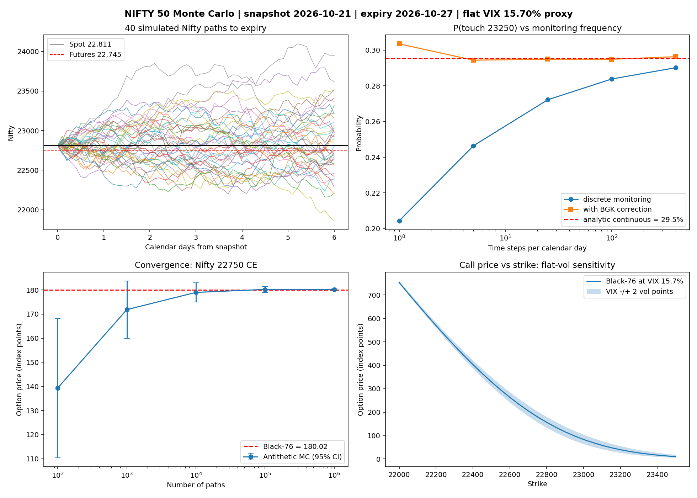

# NIFTY 50 Monte Carlo: option pricing, touch probabilities and VaR

A Monte Carlo study of NIFTY 50 index options, built to be **checked against closed-form answers** and to state its assumptions openly. Everything is in Python with `numpy` and `matplotlib` only.

> **Status: historical snapshot.** The default inputs are the close of **21 Oct 2026** (expiry 27 Oct 2026). They are transcribed from public news pages, not pulled from an exchange feed, and they go stale. The report prints a warning when the snapshot is more than 3 days old. See [Refreshing the data](#refreshing-the-data).



## What it does

| Question | Method | Check against |
|---|---|---|
| What is a Nifty call/put worth? | Monte Carlo with antithetic variates on the terminal forward price | Black-76 closed form |
| How likely is Nifty to finish beyond / touch a level before expiry? | GBM path simulation + Broadie-Glasserman-Kou barrier correction | N(d2) and the exact continuous-touch (reflection-principle) formula |
| How much can I lose on 1 lot of futures? | Monte Carlo VaR / CVaR, normal and Student-t shocks | Exact lognormal VaR |
| Is that VaR any good on real returns? | Walk-forward backtest, Kupiec and Christoffersen tests (**you supply the data**) | The tests themselves |
| How much does the flat-volatility assumption matter? | Black-76 at VIX ± 2 vol points; optional option-chain comparison | Market premiums, if supplied |

## Quick start

```bash
pip install -r requirements.txt
python run_analysis.py                          # report + figure, latest snapshot
python run_analysis.py --snapshot 2026-10-07    # an earlier dated snapshot
python run_analysis.py --history nifty.csv      # adds a walk-forward VaR backtest
python run_analysis.py --option-chain chain.csv # compares flat-VIX model to market
python var_backtest.py                          # backtest self-test on SYNTHETIC data
python -m pytest -q                             # 28 tests
```

On Windows use `python -m pip install -r requirements.txt` if `pip` is not on your PATH. Figures are saved next to the scripts (override with `--outdir`).

## Inputs and sources

Snapshot used for the sample output (`market_snapshots.json`, close of **Wed 21 Oct 2026**):

| Input | Value | Source |
|---|---|---|
| Nifty spot | 22,811.35 | [JM Financial / Capital Market, 21 Oct 2026](https://www.jmfinancialservices.in/market-news-and-insights/1738101) |
| Oct futures (exp. 27 Oct) | 22,745.00 (basis −66.35 pts) | same page |
| India VIX | 15.70 | same page |
| Risk-free rate | 5.5747% (91-day T-bill cut-off, **7 Oct** auction) | [reported RBI auction result](https://plutusias.com/?p=279438) |
| Lot size | 65 | [Kotak Neo bulletin on the lot-size revision](https://www.kotakneo.com/bulletins/lot-size-changes-in-index-derivatives-effective-december-30-2025/) |

Known gaps, stated rather than hidden:

- **Friday 23 Oct** is the latest close. Nifty ended at 22,600.00 and Business Standard reported India VIX rose about 6%, but I did not retrieve the VIX level or the futures close, so there is no 23 Oct snapshot.
- The T-bill yield is the latest *dated* auction I found (7 Oct). Over a 6-day option a few basis points change prices negligibly.
- All values were copied by hand from the cited pages. Check them against NSE before relying on them.

## Refreshing the data

Add an entry to `market_snapshots.json` (copy an existing one, change `as_of`, `spot`, `futures`, `india_vix`, `expiry`, `risk_free` and keep the `sources`). The latest `as_of` is used by default.

For the **history backtest**, download daily Nifty closes (NSE website or Yahoo Finance `^NSEI`) as a CSV with `Date` and `Close` columns. For the **option-chain comparison**, copy the NSE option chain into `option_chain_template.csv`'s format: `type,strike,price` (premium in index points) or `type,strike,iv` (percent). Make sure the chain is for the same expiry and the same moment as the snapshot, otherwise implied volatilities are meaningless (the code skips quotes that violate no-arbitrage bounds).

## Conventions and formulas

**One clock.** All times are ACT/365 years, because that is how NSE option prices and India VIX are quoted. Option expiry and path simulation use `T = calendar_days / 365` (here 6/365). A VaR horizon of `h` trading days is `h/252` years. There are no trading-day step counts anywhere; touch simulations use `steps_per_day × calendar_days` equal steps.

**Prices.** Black-76 on the futures price F:

```
d1 = [ln(F/K) + σ²T/2] / (σ√T),  d2 = d1 − σ√T
call = e^(−rT) [F N(d1) − K N(d2)]
put  = e^(−rT) [K N(−d2) − F N(−d1)]
```

Monte Carlo: `S_T = F · exp(−σ²T/2 + σ√T · Z)`, price = discounted mean payoff; antithetic pairs `(Z, −Z)` are averaged before computing the standard error because the pairs, not the individual draws, are independent.

**Paths.** GBM with drift `b = ln(F/S)/T` so that `E[S_T] = F`. Over 6 days this `b` is dominated by basis noise (here it is about −17.7% a year), so treat it as a device that fixes the mean, not as an interest rate.

**Touch probability.** With `a = ln(L/S)` and `ν = b − σ²/2`, the exact continuous-monitoring probability of touching L before T is:

```
a > 0:  N((νT − a)/(σ√T)) + exp(2νa/σ²) · N((−a − νT)/(σ√T))
a < 0:  N((a − νT)/(σ√T)) + exp(2νa/σ²) · N(( a + νT)/(σ√T))
```

Simulated paths are checked at discrete steps and so understate this. The BGK correction moves the barrier toward the spot by `exp(0.5826 σ √Δt)`.

**VaR.** `P&L = lots × F × (exp(log-return) − 1)` over `h` trading days with constant volatility; Student-t shocks are rescaled to unit variance so only the tails differ.

**Backtest.** The forecast for day *t* uses only returns before *t* (tested). Models: rolling 250-day volatility, EWMA (λ = 0.94), and filtered historical simulation. Kupiec's test checks the exception *rate*; Christoffersen's test checks that exceptions are *independent*.

## Sample output (21 Oct snapshot, run with `--today 2026-10-25`)

Full text in `run_output.txt`. Highlights:

```
call 22750 | Black-76 180.02   MC 180.11 (SE 0.200)   |err|/SE 0.47   | at VIX -/+2 pts: 156.77 .. 203.26
```

Touch probability for the 23,250 level vs monitoring frequency (exact continuous value 29.5%):

| steps / day | discrete | BGK-corrected |
|---|---|---|
| 1 | 20.4% | 30.4% |
| 25 | 27.2% | 29.5% |
| 100 | 28.4% | 29.5% |
| 400 | 29.0% | 29.6% |

Discrete monitoring understates the touch probability by about 9 points at one step per day and converges as steps increase; BGK removes most of that gap (it slightly overshoots at 1 step/day).

One-day 99% VaR on 1 lot (notional Rs 14.78 lakh): Rs 33,754 with normal shocks (exact: Rs 33,698) and Rs 38,274 with Student-t(4) shocks. The t distribution gives a *lower* 95% VaR (Rs 21,901 vs Rs 23,976) than the normal because, at equal variance, it has thinner shoulders and fatter extremes.

## Backtest self-test: synthetic data only

`python var_backtest.py` runs on simulated GARCH(1,1) returns with fat-tailed shocks (`backtest_synthetic_output.txt`):

| Model | Exceptions (expected 27.5) | Kupiec p |
|---|---|---|
| rolling | 55 | 0.000 (rejected) |
| EWMA | 51 | 0.000 (rejected) |
| filtered historical simulation | 32 | 0.401 (not rejected) |

This shows the test machinery works and that normal-quantile VaR under-covers fat-tailed data. **It is not evidence about the real Nifty.** No backtest on real Nifty returns has been run, so this project makes **no claim** about how accurate its VaR is on the actual market.

## Assumptions and limitations

1. **Flat volatility proxy.** India VIX is a 30-day implied-volatility index, not any option's implied volatility. One flat VIX is used for every strike and for the VaR. Real options show a skew; the VIX ± 2 point band changes the ATM call by about ±13%. Use `--option-chain` to compare against market premiums.
2. **Horizon mismatch.** A 30-day measure is applied to a 6-day option.
3. **Constant volatility, no jumps.** GBM has no volatility clustering and no gaps. Adding Student-t shocks changes the tails but not this.
4. **Risk-neutral probabilities.** Finishing and touch probabilities price options; they are not forecasts of where Nifty will go.
5. **Futures basis noise.** Over a few days the futures-implied carry is meaningless as an annual rate (the basis was −66 points on 21 Oct, discount, versus +15 on 7 Oct).
6. **Hand-transcribed snapshot.** See the gaps listed above.
7. **Sample size.** 100,000 paths for touch probabilities gives standard errors of roughly 0.1-0.2 percentage points.

## Tests

`pytest -q` runs 28 tests, including: Black-76 against a textbook value and put-call parity; implied-volatility round trip; Monte Carlo prices within 4 standard errors of Black-76 for six contracts; standard error falling as 1/√N; antithetic variance reduction; the touch formula against the driftless closed form; BGK correction improving on discrete monitoring; MC VaR against exact lognormal VaR; Kupiec against a hand calculation; Christoffersen detecting clustered exceptions; **no look-ahead** in VaR forecasts (changing future returns must not change earlier forecasts); and the CSV and snapshot loaders.

## Project layout

```
nifty_mc.py               core library (snapshot loader, Black-76, implied vol, MC pricing, touch, VaR)
run_analysis.py           report and figure
var_backtest.py           walk-forward VaR backtest, Kupiec and Christoffersen tests
market_snapshots.json     dated inputs with sources
option_chain_template.csv header for an option-chain file
tests/test_nifty_mc.py    test suite
run_output.txt            sample report output
nifty_mc_results.png      sample figure
var_backtest_synthetic.png, backtest_synthetic_output.txt   synthetic backtest self-test
```

## AI assistance

This project was developed with help from an AI assistant (Claude). Edit this section to describe your own contributions accurately, and check your programme's policy on AI-assisted work.

*Educational use only; not investment advice.*
